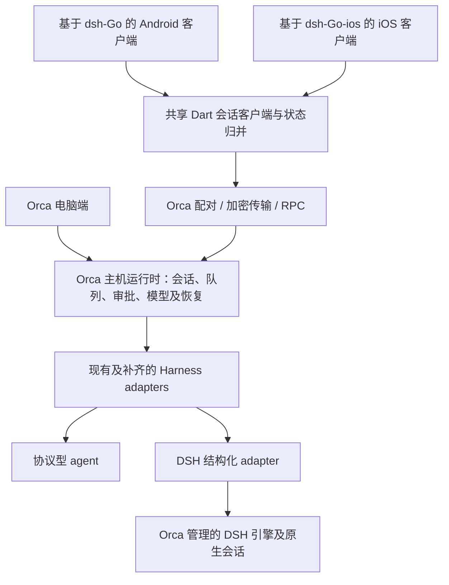

# Orca 多 Harness 与 Flutter 移动端整合计划

创建日期：2026-11-17

最近修订：2026-11-17，修订 R01

状态：按用户澄清更新的实施计划；尚未实施应用代码、运行验证或发布。

正文表示当前有效方案；第 9 节按时间顺序保留修订原因、旧约定、新约定及影响位置。后续修订更新正文并追加记录，不删除或改写已有修订记录；历史方案不与当前正文同时作为验收要求。

本次确认：复用 dsh-Go/iOS 的 Flutter 壳子，数据层适配 Orca，UI 按用户要求调整；DSH 作为 Orca 的结构化 agent 接入，在 Orca 自己的 GUI 中聊天。这里的 GUI 不指独立 DSH Desktop 应用。

## 1. 目标与需求基线

建设一个电脑和手机共同使用的多 Harness 工作台：Orca 提供电脑端及运行底座，dsh-Go 和 dsh-Go-ios 提供 Flutter 移动端基础。电脑与手机进入同一会话，通过统一的主机服务提交消息、读取状态和回答审批。

| 编号 | 已确认需求                                                                | 不得替代为                                                    |
| ---- | ------------------------------------------------------------------------- | ------------------------------------------------------------- |
| R1   | 复用 Orca 的多 agent/harness 接入、工作区管理、会话生命周期和桌面开发能力 | 重新开发一套 agent 引擎，或让多个后端共同管理同一会话         |
| R2   | 首批覆盖 Orca 已有 agent，并补齐 DSH 结构化 adapter，在 Orca GUI 中使用           | 只完成 Claude/Codex 就宣称首批完成；用独立 DSH 页面替代 Orca GUI |
| R3   | 复用 dsh-Go、dsh-Go-ios 的 Flutter 壳子，数据层接 Orca，UI 按用户要求调整      | 直接嵌入 Orca 页面作为主要聊天 UI                             |
| R4   | Orca 管理的会话在电脑和手机展示结构化聊天，支持模型切换            | 把终端字符流装进聊天气泡；自动跳转终端完成核心操作            |
| R5   | 三级组织：主机 → 工作目录 → 会话；会话展示 harness logo 和名称            | 增加必须进入的第四级 harness 目录；同名目录跨主机混在一起     |
| R6   | 双端共同查看、编辑、提交，不需要抢占或收回聊天控制权                      | 手机接入后锁住电脑聊天；复制新会话冒充接续原会话              |
| R7   | 普通消息由主机按接收登记顺序排队，上一条回答结束后处理下一条              | 默认打断当前回复，或把多次提交合并成一条 prompt               |
| R8   | 两端均可审批，正常先到先生效；尚未生效的冲突以电脑端为准                  | 已执行后重新覆盖审批；为所有手机审批增加电脑确认步骤          |
| R9   | 同步真实模型列表、当前模型、参数、运行状态、队列及审批结果                | 手机用内置列表冒充主机模型目录；界面切换成功但实际模型未切换  |
| R10  | 支持断线、后台、重启后的同会话恢复；视图关闭不结束主机任务                | 依赖手机持续在线运行任务；恢复时盲目重发不确定的操作          |

Happy、ds-harness-remote 是设计与局部实现参考，不作为新的会话生命周期管理者。独立终端工具可以保留，但不用于替代 R4 的聊天验收。

实施范围不包含把 DSH-Go 的伙伴、插件市场、本机引擎等所有专有功能重新实现到 Orca，也不包含新建公共云产品。现有无关功能应避免被破坏。DSH 结构化 adapter 和新增移动客户端连接能力属于本计划范围。独立 DSH Desktop、Claude/ChatGPT 等外部 GUI 的窗口接管，以及任意外部已运行终端/GUI 会话的原位接续，不是本次必要条件。保留 Orca 原有终端能力，不把其输入权机制当成聊天协作方案。

## 2. 当前基础与必须先证明的条件

### 2.1 已有可复用基础

- Orca 已有结构化 session registry、provider adapters、会话记录、运行所有权、持久化 journal、操作回执、历史 cursor 和消息队列。
- Orca 已有手机配对、加密通信、RPC、能力协商和远程主机路由。Flutter 优先适配这条现有链路，不同时引入 ds-remote 的另一套配对协议。
- Orca 终端和终端背后的聊天视图存在 mobile driver 输入锁；结构化聊天是另一条接入路径，不能通过简单删除输入锁来实现双端协作。
- Orca 已有 `dsh` agent ID 和 `dsh-tui` 启动入口。本计划的“增加 DSH”是补齐 DSH 结构化聊天 adapter，优先沿用现有身份，不再建立一个重复 agent。
- dsh-Go/iOS 的聊天状态、事件归并和网络接口依赖 DshClient/Typert。页面可复用，数据层需要接入 Orca；这包含业务事件和状态转换，不只是更换网络地址。
- ds-harness-remote 的 Gateway 桥接可作为 DSH 接口参考；Orca 已有自己的远程协议。目标链路不要求部署 Remote Server 或经过 Remote 插件，是否需要轻量 DSH 插件由接口验证决定。
- 上述为源码检查结论，不能替代实际启动、协议互通及真机验收。

### 2.2 实施前验证的四个关键条件

1. **DSH adapter 接口**：验证 Orca 能启动或连接由其管理的 DSH 引擎，完成会话创建/恢复、消息发送、事件订阅、模型切换、审批与停止。优先使用正式结构化接口，参考 Remote 的 Typert Gateway 桥接；不预设 ACP 或某个启动 profile 已满足全部能力。
2. **Flutter 数据适配**：核对 Orca 配对、加密、RPC 与会话事件如何进入 Flutter 状态层，明确 DshClient/Typert 依赖的替换边界。
3. **统一操作入口**：验证 Orca GUI 与手机的发送、模型选择和审批走同一主机服务；无需拦截独立 DSH Desktop 的原生输入。
4. **Agent 覆盖**：Orca 的 CLI 名单大于结构化聊天名单。盘点全部基线 agent 的结构化能力及缺口；可启动 CLI 不等于手机完整支持。

缺少可靠接口的 agent 记录具体缺口和补齐路线，仍视为未完成。本次排除外部运行中会话接管，不等于缩小原有 agent 清单；全量支持与代表性闭环分别验收。

## 3. 目标架构与职责

### 3.1 主机职责

- Orca 是客户端会话身份、操作回执、提交队列和状态发布的统一入口。
- 保留各 harness 的原生会话标识和恢复句柄；不修改其原生存储来伪造统一历史。
- 对 DSH，Orca 通过 adapter 管理启动/连接、会话与生命周期协调；原生上下文、模型调用及工具执行仍由 DSH 引擎负责。电脑聊天使用 Orca 自己的 GUI，不要求独立 DSH Desktop 进程参与。
- 桌面端和手机端均经过相同的提交与审批裁决逻辑，不保留绕过队列的正常聊天发送路径。
- adapter 负责协议差异，客户端按能力字段展示，避免 Flutter 为每个 agent 复制一套完整状态机。

### 3.2 Flutter 复用边界

- 复用现有页面、聊天组件、草稿、附件入口、主题、本地化和平台能力；Orca 协议事件适配为 Flutter 展示模型。
- 新增纯 Dart 的 Orca 客户端包，暂定 `orca_client`，与现有 `dsh_client` 并列。Orca 调用不伪装成 DSH/Typert API。
- 在聊天数据入口引入必要的后端边界，使页面不再直接绑定 DshClient；只抽取本次必需的会话、模型、队列、审批和历史操作。
- Android/iOS 使用同一版本的客户端包及一致性样例，不分别维护两份协议和业务规则。P0 确定包的唯一维护位置及本地开发、构建引用方式。
- 两个平台的 UI 和原生工程可以继续在原仓库维护；不以仓库合并为前置条件。
- 桌面 UI 变更遵循 Orca STYLEGUIDE；Flutter 以 dsh-Go/iOS 为壳子，页面、导航和交互按用户要求调整，不把现有布局冻结为最终设计。
- Orca 主链路由 `orca_client` 替代 DSH 客户端调用；旧 DSH 连接模式是否继续作为产品入口另行明确，不在本次文档修订中删除既有能力。Android PRoot 本地引擎不属于复用壳子的必要依赖。

### 3.3 身份与目录

- 复用现有 host、workspace、session、provider handle；客户端以主机与会话身份联合定位，不以标题或路径充当会话 ID。
- 目录按实际执行主机和 workspace 归属展示；支持普通文件夹与 Git worktree，不能强制创建 worktree。
- 同路径在不同主机、WSL 或执行环境中不能混淆。显示用的主机名称变化不改变身份。
- 一条会话展示标题、harness logo/名称和状态；同一目录允许同 harness 多会话及不同 harness 并存。
- Orca 编排的父子任务和 harness 内部子 agent 使用已有关系展示，保持含义区分，不增加强制导航层级。本期不重做编排调度器。

## 4. 必须统一的行为契约

### 4.1 消息提交与队列

1. 两端草稿独立，按设备和会话保存；不实时覆盖另一端未发送文字。
2. 客户端为一次提交生成稳定操作 ID。主机持久化操作、顺序及回执后，才回答“已接收”。
3. 以主机登记序号排序，不使用客户端时钟排序。当前轮执行期间，普通发送进入队列，保留每次提交边界。
4. 正常完成后处理下一条。错误、进程崩溃或未确认的中断不视为正常完成，保留队列并显示暂停原因，恢复后继续。
5. 明确区分普通发送、停止当前轮与停止会话。停止当前轮默认暂停队列，避免刚停止就被下一条立即重新启动；用户明确继续后才恢复。
6. 复用操作回执查询重复提交；结果不确定时先核实，不新建操作 ID 盲目重发。不声称可以在所有 provider 故障边界保证外部副作用恰好执行一次。
7. Orca GUI 与手机的普通 prompt 必须进入同一有序入口。独立外部终端/GUI 的发送不属于本次统一队列保证；保留的原始终端输入不可被宣称已获得结构化聊天的排序保证。

### 4.2 审批

- 审批以主机保存的请求 ID、修订号和待处理状态为准；两端都可提交答案。
- 正常先到的有效答案立即结算，不等待另一端，也不要求电脑在线确认。
- “冲突”限定为：同一未结算修订上，在主机提交最终结果之前，已经收到互相矛盾的候选答案。此时电脑端优先；相同答案视为重复。
- 已经结算的审批收到迟到答案时，返回已生效结果；不能覆盖已执行动作。客户端点击时间相近，不自动构成可追溯覆盖的冲突。
- 裁决在现有主机串行处理/事务边界中完成，记录来源和最终结果。设备来源由认证连接确定，不相信客户端自报“我是电脑”。
- 不人为增加所有审批的等待窗口。若实际裁决实现不能形成多个未结算候选，应如实说明此时退化为正常先到先生效；不得宣称能够预测未来的电脑答案。
- 重连不恢复过期审批为待处理；两端及时关闭已结算卡片。

### 4.3 模型与参数

- 目录按执行主机、harness、账号和工作区上下文获取；活动会话使用其实际绑定的账号与上下文。
- 两端分别读取“可选模型目录”“会话已确认选择”“某条消息提交时的选择”，不能混为一个本地字段。
- 模型/effort 变更经主机验证，收到 adapter 确认才显示为已生效；失败保留原值并展示原因。
- 普通排队消息记录主机接受时的模型与参数选择。后续改模型默认影响后续提交，不偷偷改变已经接收的消息；执行前按 adapter 能力应用并确认。
- 需要重启才能切换的 harness，必须证明可以恢复原会话上下文；不能创建新会话后标成切换成功。
- 目录失败可显示最近一次成功结果及过期状态；无可信目录时明确显示不可用，不伪造主机模型列表。单模型 harness 明确展示唯一选项。
- 账号、目录或主机切换后清理错误作用域的缓存；同一会话的选择变更向所有订阅端发布。

### 4.4 结构化展示与恢复

- 将 provider 事件归并为用户消息、回答、推理（若有）、工具调用/结果、审批/问题、附件、队列与状态，不依靠终端截图或 ANSI 文本猜测关键执行状态。
- 优先复用 Orca journal/cursor/epoch 语义；先取得一致快照再订阅/补齐，避免分页和实时事件交错造成重复、丢失或乱序。
- 未识别的非关键事件可显示说明；审批、执行结果等关键事件不能静默丢弃并宣称完整支持。
- 手机断线或后台暂停订阅不停止主机任务；重连重新认证、协商能力、校准 epoch，并补齐当前状态。
- 区分关闭页面、关闭桌面窗口、显式退出运行时、停止当前轮、结束会话、主机重启。显式彻底退出或主机重启不承诺保活进程。
- 验证 Orca GUI 关闭与 Orca 后端、DSH 子进程的生命周期边界。正常关闭界面应按运行时设计保留任务；显式退出或主机重启后发布真实中断状态。不以独立 DSH Desktop 窗口保活作为验收条件。

## 5. 分阶段实施

阶段顺序：P0 → P1 → P2；P3/P4 依赖前面的统一契约；P5 完成产品整合；P6 完成全范围验收。一个代表性 agent 跑通只是里程碑，不等于首批完成。

### P0：基线盘点与接入可行性验证

**做什么**

- 锁定 Orca、两个 Flutter 仓库及 DSH 引擎的实施基线版本，保留各仓库现有改动。
- 从 Orca 实际注册表生成全量 agent 清单，逐行记录：平台、启动形态、协议、Orca 管理会话的创建/resume、历史、运行事件、模型、审批、停止、GUI 提交入口和已验证状态。
- 验证 Flutter ↔ Orca Codex 会话、Orca GUI ↔ DSH adapter、手机 ↔ Orca ↔ 同一 DSH 会话三条代表性路径。
- 确定共享 Dart 包的唯一维护位置；核对现有 UI、草稿、附件和原生层复用范围。

**怎么做**

- 优先读现有 adapters、Flutter 数据入口、Orca 手机协议和 DSH Gateway/plugin，不先写通用终端解析器。
- 使用可丢弃的测试会话记录真实会话 ID、模型报告、事件和恢复行为；不操作用户正在执行的任务。
- DSH 验证从 Orca GUI 创建会话，再由手机读取、发送、切换模型，并确认两端对应同一 Orca 会话及 DSH 原生会话。

**产出与通过条件**

- 全量能力矩阵，每项有代码/实测依据或明确缺口；不能用未安装、未验证代替通过。
- 三条代表路径有明确结论；识别结构化接口、Dart 互通和双端状态同步的实际缺口。
- 如有达不到硬需求的路径，给出补齐路线或需要用户决策的范围变化；未解决前不承诺全范围交付时间。

### P1：统一主机行为与客户端契约

**做什么**

- 扩展既有 Orca 会话边界，落实消息队列、审批裁决、模型确认和状态订阅规则。
- 梳理 Flutter 需要的最小 RPC 集合：主机能力、目录/会话、历史/事件、创建/附着、发送/回执/队列、停止、审批、模型目录/切换。
- 补齐能力协商和可区分的错误：不支持、权限不足、未登录、连接断开、操作结果未知。

**怎么做**

- 优先扩展 `agentSession.*`、现有 journal、lease/fence、command receipts 和 queued messages，不建立第二套数据库或所有权服务。
- 桌面聊天提交与移动提交使用同一服务；普通发送策略不再随 provider 的 steering 能力改变。
- 协议采用可兼容新增字段；旧客户端不支持的新行为明确协商，不静默改字段含义。

**通过条件**

- 两个独立客户端提交后，主机生成一致队列及可查询回执；模拟响应丢失后不重复发送。
- 审批正常、重复、冲突和迟到四种路径均有确定结果。
- 模型切换经真实 adapter 确认；事件与回执可以支撑 Flutter，无需依赖 Electron 视图存在。

### P2：Flutter 客户端与单 Harness 完整闭环

**做什么**

- 在共享 Dart 包实现 Orca 配对/凭据保存、加密连接、能力协商、RPC、事件重连及状态归并。
- 在现有 Flutter 聊天数据入口接入 Orca，先以 Codex 完成最小完整流程。

**怎么做**

- 参考 Orca 现有手机端的线协议和加密实现，用跨语言样例验证互通；直接连接与既有 relay 链路都要验证。
- 用平台安全存储保存设备凭据；切换主机隔离连接、草稿和缓存。
- 复用现有聊天组件，先实现创建/打开同一会话、历史、流式回复、工具、队列、审批、模型和停止，不先重画整个 App。

**通过条件**

- Android/iOS 真机均能连接 Orca；电脑与手机看到同一 Codex 会话。
- 一条任务从电脑开始，手机继续；另一条从手机开始，电脑继续；操作不会新建副本或抢占输入。
- 手机杀进程后重开能补齐状态；新增包不依赖 Flutter，可独立验证协议逻辑。

### P3：DSH 结构化 adapter

**做什么**

- 在既有 `dsh` agent 身份下注册结构化 adapter，使用户在 Orca GUI 内选择 DSH 并聊天。
- 接入 DSH 引擎的会话、事件、模型、审批、停止与恢复接口。

**怎么做**

- 沿用 Orca adapter 工厂、会话记录、模型目录及事件发布机制，参考 ds-remote 的 Gateway 调用经验。
- 根据 P0 证据选择 DSH 的正式启动方式与结构化接口；需要时补轻量插件/桥接，不引入 Remote 的完整账号、中继或会话管理系统。
- 保留 DSH 原生会话 ID、工作区与恢复句柄；Orca 负责统一操作入口，DSH 负责上下文和工具执行。
- DSH 的具体启动命令/profile 由 P0 确认；不以独立 dsh-web 页面替代 Orca GUI，也不把旧版“绝不能出现 dsh-web 进程”的形态限制当作协议选型结论。

**通过条件**

- 从 Orca GUI 创建 DSH 会话，手机打开并继续同一会话；双方消息、模型与审批一致。
- 双端连续发送按主机队列处理，模型切换实际生效；断线和 adapter 重连不创建会话副本。
- 启动、停止、恢复及关闭 Orca 界面的进程行为有实际结果；无需启动或接管独立 DSH Desktop GUI。

### P4：补齐基线 Agent 的结构化能力

**做什么**

- 按 P0 矩阵补齐 Orca 基线 agent 在 Orca 管理会话中的手机结构化支持。
- 区分已有结构化 adapter、仅终端启动入口和需要新增 adapter 的 agent；保留原有终端功能。

**怎么做**

- 优先复用正式结构化接口及现有 adapter，transcript reader 只承担可证明的历史/观察职责。
- 逐项验证创建、恢复、消息、事件、模型、审批和停止；仅支持启动参数选模型的实现须验证原会话恢复能力。
- 手机和 Orca GUI 均通过统一会话服务发送。任意外部已运行终端或独立 GUI 的附着、输入拦截与迁移不在本阶段范围。

**通过条件**

- 每个基线 agent 的适用平台有明确结果，手机无需终端完成聊天、模型切换和其支持的审批。
- 不以增加图标、只读历史或启动 CLI 宣布完成；阻塞项不计入全量通过，也不影响如实交付已完成的代表性闭环。
- 不减少 agent 清单来掩盖结构化适配缺口；确需改变覆盖范围时另行确认。

### P5：移动端产品整合与双端一致性

**做什么**

- 完成主机 → 目录 → 会话三级导航和 harness logo 展示。
- 完成 dsh-Go 风格聊天、模型/参数选择、排队状态、审批、恢复提示和独立终端入口。
- 对齐电脑侧的队列、审批和模型反馈。

**怎么做**

- 目录页同时展示多 harness、多会话；复用 Orca 的编排关系与状态信息，不把父子任务与不同主机混为一层。
- 处理同名目录、重命名、普通文件夹、worktree、远程主机离线、长历史与中文输入法。
- 真机验证键盘、滚动、附件、切后台和横竖屏；桌面样式遵循 Orca 规范。
- 明确未知/失败/过期状态，不能显示永久加载、假模型选项或假成功。

**通过条件**

- iOS/Android 使用同一套业务规则；复用 dsh-Go/iOS 壳子，视觉与交互符合用户后续确认的 UI 要求。
- 正常聊天无自动终端切换、无“收回”提示；两端同时输入不覆盖草稿。
- 修改模型、结算审批、队列变化和任务完成均在另一端收敛到主机状态。

### P6：故障恢复、跨平台回归与交付

**做什么**

- 执行第 6 节验收矩阵，覆盖真实 agent、Orca 管理的真实 DSH 引擎、真实网络与移动设备。
- 验证新旧客户端兼容、主机重启、更新后恢复及已有桌面能力回归。

**怎么做**

- 仅为协议、队列、审批竞争、恢复等真实行为缺口补充必要测试；优先复用已有测试。
- 按改动面执行 Orca 类型检查、lint 和相关测试；Flutter/Dart 执行各自 analyze/test。
- Orca 渲染验证按仓库要求使用后台启动和 Playwright CDP；不弹出抢焦点窗口。移动端真机测试单独安排，不能用桌面测试替代。
- Native-focus 测试使用隔离环境/CI；跨平台进程、路径、shell 改动遵循仓库跨平台规范。
- 如进入提交推送阶段，最后一次编辑/rebase 后、每次 push 前运行 `pnpm check:changed`；本计划不包含自动发布。

**通过条件**

- 验收矩阵中的硬性条件全部满足；未跑项明确标为未验证，不能按通过统计。
- 交付可安装的移动测试构建、对应 Orca/DSH adapter（及必要插件）构建与版本组合说明；不以发布应用商店为验收前提。
- 保留缺陷与验收记录，说明实际覆盖平台、agent 版本和故障条件。

## 6. 验收矩阵

以下场景均在主机日志/回执与两个客户端交叉验证，不只看手机是否出现一条气泡。

| 编号 | 操作或故障场景                                     | 通过标准                                                                                     |
| ---- | -------------------------------------------------- | -------------------------------------------------------------------------------------------- |
| A01  | 遍历 Orca 基线 agent 与 DSH 结构化 adapter            | 逐项完成适用平台上的新建、原会话继续、历史、发送、停止、模型及所支持的审批验证；缺口不算通过 |
| A02  | 从 Orca GUI 已有结构化会话打开手机                        | Orca 与 provider 会话身份及上下文连续；手机为结构化聊天，无复制副本、无自动终端回退                       |
| A03  | 进入两个主机上的同名目录                           | 会话不串主机；三级导航正确；普通文件夹与 worktree 均可用                                     |
| A04  | 同目录建立多个同/不同 harness 会话                 | logo、名称和状态正确；选择会话不误入其他 harness                                             |
| A05  | 两端同时编辑不同草稿                               | 草稿互不覆盖；无聊天输入锁或收回控制权要求                                                   |
| A06  | agent 回答中，两端按主机登记顺序提交 A/B/C         | A/B/C 独立保留，当前轮结束后按序执行，不自动 steering、不合并 prompt                         |
| A07  | 手机提交后主机已接收，但回复丢失                   | 重连用原操作 ID 查到回执；不能生成第二条有效提交；无法确认时明确显示未知                     |
| A08  | 停止当前轮、provider 异常或崩溃                    | 队列保留且暂停；状态明确；恢复/继续后不重复执行已确认完成的消息                              |
| A09  | 只有手机或只有电脑回答审批                         | 首个有效答案正常生效，无另一端确认要求                                                       |
| A10  | 同审批提交相同答案、未结算冲突答案、结算后迟到答案 | 分别去重、电脑优先、返回既有结果；每个审批只结算一次                                         |
| A11  | 电脑不在线，手机处理审批                           | 手机可独立完成；不因电脑优先策略永久等待                                                     |
| A12  | 两端读取相同会话模型目录并切换模型/effort          | 列表作用域正确；切换由 agent 确认；新一轮实际使用选择值，两端一致                            |
| A13  | 有排队消息时更改模型，再提交新消息                 | 已排队消息使用已记录选择，新消息使用新确认选择；两端显示与实际一致                           |
| A14  | 模型查询失败、账号或工作区切换                     | 不冒用默认列表或其他账号缓存；失败与过期状态明确，可恢复                                     |
| A15  | Orca GUI 创建 DSH 会话并双端操作                     | 经 DSH adapter 使用同一原生会话；Orca GUI 与手机的模型、队列、审批和历史一致，无独立 Desktop GUI 依赖                   |
| A16  | 手机断网、Wi-Fi/蜂窝切换、后台 1/5/15 分钟后返回   | 主机任务不受影响；连接恢复后补齐消息和状态，已结算审批不复活                                 |
| A17  | 手机强制结束后重新启动                             | 主机与会话定位恢复，已接收消息不重复，已保存草稿可恢复                                       |
| A18  | 关闭 Orca 正常界面窗口                         | 按运行时设计继续执行任务；手机可观察，重新打开界面可回到同一会话                             |
| A19  | 显式彻底退出或重启执行主机                         | 不伪装进程仍活着；恢复持久历史和正确中断状态，支持的会话可继续，未知操作不盲目重放           |
| A20  | 长历史分页时同时收到新事件                         | 工具与结果配对正确，无丢失、重复、顺序倒退或切会话串流                                       |
| A21  | 旧客户端/主机缺少新增能力                          | 明确协商或要求升级；不偷偷退回终端、伪造模型目录或重复创建会话                               |
| A22  | 回归 Orca 原有桌面能力                             | agent 启动、工作区、终端、Git/diff 及已覆盖编排能力不出现本次引入的回归                      |

覆盖范围：Android 与 iOS 真机；Orca 支持的 macOS/Windows/Linux 执行主机；适用的本地、paired remote、SSH/WSL 执行路径；普通文件夹与 Git worktree。某 harness 本身不支持的平台明确记录为不适用，不能用它掩盖原本支持的平台未测试。缺少设备、账号或上游接口的项目记为未验证/阻塞。

性能验收使用 P0 的同设备、同网络、同会话基线，记录连接恢复时间、首屏历史时间、提交确认延迟与长会话滚动表现。P0 固定具体设备、网络条件和验收阈值后再执行；本计划不把未经测量的秒数作为承诺。

## 7. 代码落点与参考

| 范围             | 现有入口/参考                                                                                                                   | 计划用途                                           |
| ---------------- | ------------------------------------------------------------------------------------------------------------------------------- | -------------------------------------------------- |
| Orca agent 清单  | `src/shared/agent-launch/catalog/tui-agent.ts`、`tui-agent-selection.ts`                                                        | 冻结首批清单，保留原有接入                         |
| 结构化运行时     | `src/main/runtime/agent-session/installation/structured-agent-runtime-metadata.ts`、`structured-agent-runtime-registrations.ts` | 注册、复用及补齐 adapter                           |
| 会话状态与协议   | `src/shared/agent-session/`、`src/main/native-chat/agent-session-wire/`、`agent-session-journal/`                               | 身份、回执、队列、审批和恢复                       |
| 模型目录         | `src/main/native-chat/agent-model-catalog/`、`src/shared/agent-session/options/`                                                | 主机目录与会话选择统一                             |
| 终端输入与聊天   | `src/renderer/src/components/terminal-pane/`、`src/renderer/src/components/native-chat/`                                        | 正常消息提交协调，保留原始终端输入边界             |
| 现有手机协议     | `mobile/src/transport/`、`mobile/src/pairing/`、`mobile/src/session/native-chat/`                                               | Dart 互通和行为参考                                |
| DSH adapter 参考 | `/Users/joseph/projects/ds-harness-remote/packages/plugin/src/harness-remote-bridge.ts`、`typert-gateway-contract.ts`           | DSH Gateway 接口与事件映射参考                         |
| Flutter 数据入口 | 两个移动仓库的 `app/lib/state/connection_state.dart`、`chat_state.dart` 与 `packages/dsh_client/`                               | 隔离 DSH 依赖，复用展示层                          |
| Happy 参考       | `/Users/joseph/projects/happy/packages/happy-cli/src/api/apiSession.ts`、`src/daemon/modelCatalog.ts`                           | 消息补齐、回执及目录发现经验；不直接替换 Orca 协议 |

路径均为计划编写时的定位入口，实施前需按锁定基线重新核对。Happy 新运行时与旧 CLI 的语义不同，不直接复制旧版 local/remote 模式切换作为双端方案。

## 8. 完成定义与执行边界

- P0 能力矩阵全覆盖，不遗漏原有 agent；任何范围变化均另行确认。
- P1–P6 产物完成，A01–A22 在适用组合上有实际结果；阻塞和未验证不被算作完成。
- 手机统一聊天、模型切换、双端共同操作、Orca GUI 中的 DSH 结构化接入这四项是硬性条件，不能互相替代。
- 不预设总工期。P0 后按真实缺口估算每个 adapter、Dart 协议适配和真机验证工作量；中间里程碑与全范围交付分别说明。
- 本次只交付本计划。后续实施授权后才修改应用代码；部署、上架、迁移用户真实会话不由本计划自动触发。

## 9. 线性修订记录

记录规则：按发生顺序追加；同日用 R00、R01 等递增编号区分。每次记录原因、决策、影响范围、验证状态及可定位的版本。正文持续维护当前有效方案，旧决策仅在本节和 Git 历史中保留，不能再次作为当前验收门槛。尚未提交的修订标记为本地修改；后续记录关联已提交修订的提交号，不回写历史状态，不编造版本。

### R00 · 2026-11-17 · 初始计划

- **版本依据**：`docs/flutter-multi-harness-plan` 分支，提交 `10cd4d95c29e02e9057f4037a08ff1e35cfd0fb7`。
- **当时方案**：Orca 统一主机服务，复用 Flutter 客户端；DSH 以独立 Desktop 实例桥接接入，要求接续 Desktop 已有原生会话，同时把已有终端/外部 GUI 接续列为全范围验收条件。
- **状态**：只编写计划，未实施应用代码或运行验证。
- **后续关系**：其中独立 Desktop 接入、外部运行中会话接管及相关进程限制由 R01 替代，其余仍有效的需求已保留在正文。

### R01 · 2026-11-17 · 澄清 Flutter 壳子与 Orca GUI 中的 DSH 接入

**为什么更新**

用户在本次讨论中明确：主要需要 dsh-Go 的壳子，数据层改为适配 Orca，UI 按其要求调整；并指出 Orca 已经提供 GUI 对话。进一步确认的调用链是“Flutter → Orca → DSH adapter → DSH 引擎”，电脑使用 Orca 自己的 GUI。此前将“桌面 GUI 中使用 DSH”理解成“接管独立 DSH Desktop 实例及窗口”，导致文档加入了不必要的外部实例附着、原生输入协调与窗口保活要求，扩大了核心集成范围。用户随后要求更新原文档并保留线性原因记录。

**决策及影响**

| 主题 | R00 旧约定 | R01 当前约定 | 影响位置 |
| ---- | ---------- | ------------ | -------- |
| 移动端 | 复用 Flutter 产品，强调延续既有样式 | 复用 Flutter 壳子，协议和业务状态接 Orca，UI 按用户要求调整 | R3、2.2、3.2、P2、P5 |
| DSH 接入 | 桥接独立 DSH Desktop 已有实例 | 新增 DSH 结构化 adapter，由 Orca 管理，在 Orca GUI 中使用 | R2、2.1–2.2、架构图、3.1、P0、P3、A15 |
| 会话范围 | 任意已有终端/外部 GUI 原位接续 | 核心验收针对 Orca 管理的会话；外部会话接管不作为必要条件 | R4、2.2、4.1、P0、P4、A02 |
| 提交与保活 | 协调独立 Desktop 原生提交和窗口生命周期 | 双端通过 Orca 提交；验证 Orca 后端与 DSH 引擎生命周期 | 4.1、4.4、P3、A18 |
| dsh-web 限制 | 不允许 dsh-web 进程参与 | 禁止用独立页面替代 Orca GUI；引擎启动方式按正式接口验证决定 | R2、P3、A15 |
| Remote 职责 | 作为桥接与协议经验参考 | 保持参考定位，Orca 主链路无需部署 Remote 服务 | 2.1、P3 |

**保持不变**

- Orca 统一主机与会话管理；Flutter Android/iOS 复用共享 Dart 客户端。
- 主机 → 目录 → 会话三级组织，真实模型目录、双端排队与审批、断线恢复。
- Orca 原有 agent 覆盖目标不因排除外部 GUI 接管而自动缩减；CLI 能启动不等于结构化验收通过。
- 不引入第二套会话生命周期管理者，不自动部署、上架或迁移真实用户会话。

**证据与验证状态**

- 本次源码分析基线：Orca `7593dd1312`；dsh-Go `9b7aa9bb`；dsh-Go-ios `9c791aa`；ds-harness-remote `44bcc2cb`。这些是分析版本，不是已锁定的实施或发布版本。
- 已读取 Orca adapter 注册、会话协议、Flutter DshClient/Carrier 和 Remote Gateway 桥接代码；确认存在可复用边界，不代表 DSH adapter 或 Dart Orca 客户端已经实现。
- 本次仅修订文档。DSH 启动协议、完整接口覆盖、两端互通、真机与生命周期仍由 P0 及后续阶段验证，不在此承诺整体工期。
- 版本状态：本地文档修改，尚未提交或推送；历史基线可用 R00 提交号查阅。
